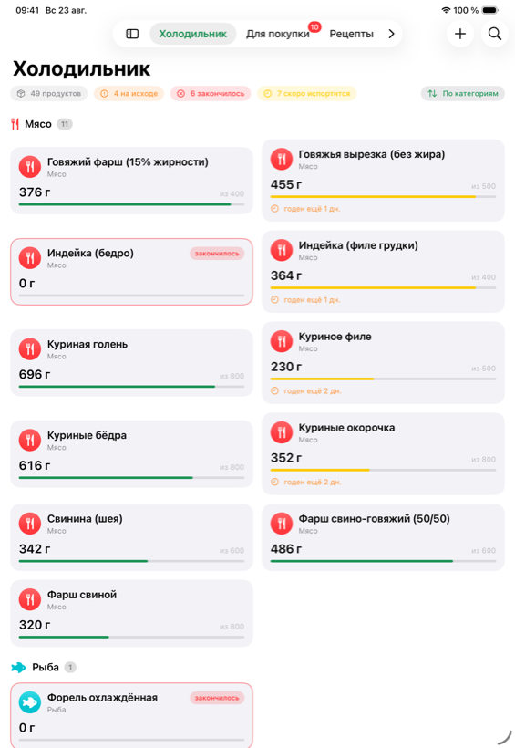
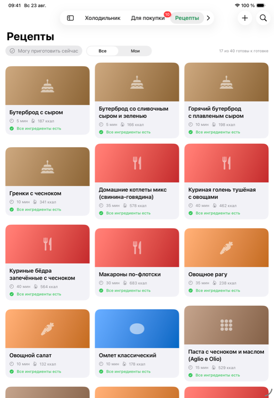
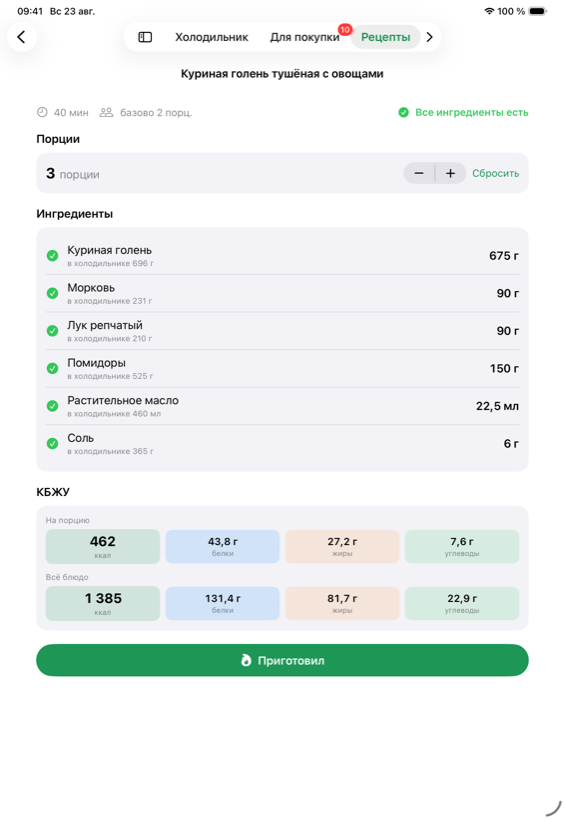
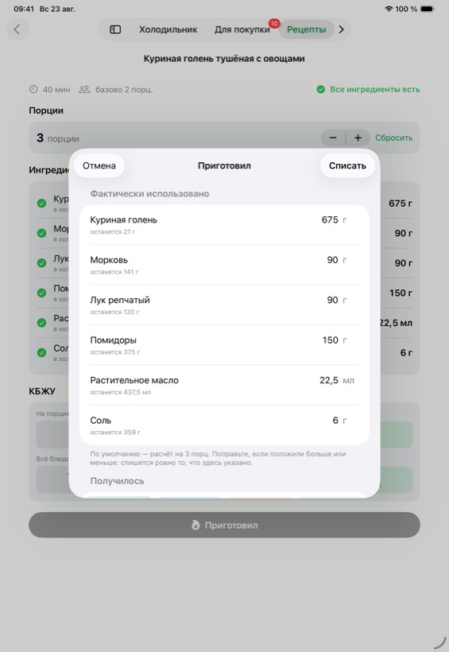
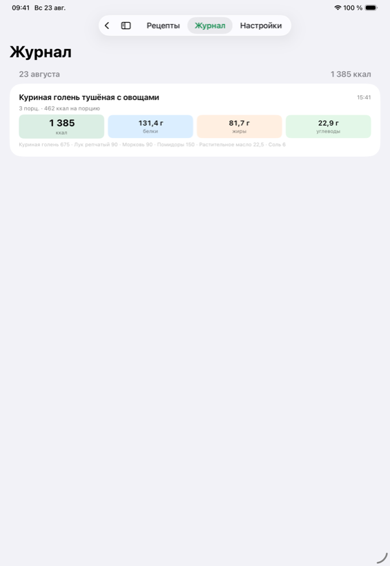
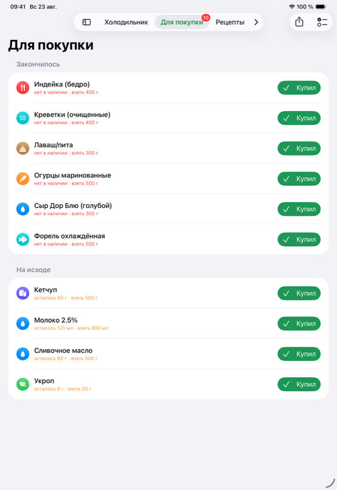
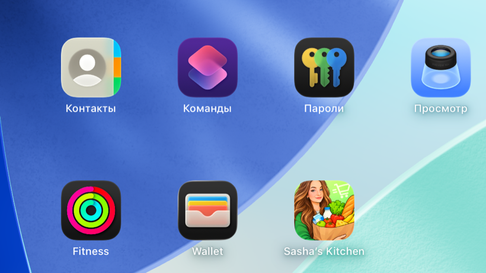

# Sasha’s Kitchen

**Приложение для учёта продуктов дома — для iPhone, iPad, Mac и Apple Watch.** Показывает, что лежит в
холодильнике, что из этого можно приготовить прямо сейчас и сколько это в КБЖУ.
При готовке фактически использованный вес списывается с остатков, а то, что
закончилось, само собирается во вкладку «Для покупки» — оттуда список уходит в
Напоминания настоящим чек-листом или текстом в iMessage и Заметки.

Холодильник, рецепты, список покупок и журнал синхронизируются между
устройствами через iCloud, а список покупок можно открыть другому человеку:
он увидит его у себя в приложении, отметит купленное и допишет своё. На часах —
тот же список с отметкой «купил». В списке покупок — свои позиции с галочками, а сканер
штрихкодов находит продукт в базе Open Food Facts: название, бренд, КБЖУ — и
кладёт его в список или в холодильник. Интерфейс на 11 языках: русский,
английский, немецкий, французский, испанский, итальянский, португальский
(Бразилия), японский, корейский, китайский (упрощённый) и тайский; продукты и
покупки можно вписывать на любом языке.

SwiftUI + SwiftData + CloudKit, Swift 6, без внешних зависимостей. iOS/iPadOS 26
и новее, Mac — через Mac Catalyst, watchOS 26 и новее.

<br clear="right">

---

## Как это работает

### Холодильник

49 продуктов с остатками, прогресс-баром от изначального объёма и подсветкой
того, что заканчивается или скоро испортится. Поиск, сортировка по категориям,
остатку, сроку годности или названию.



### Рецепты

40 рецептов. У каждого — бейдж «Все ингредиенты есть» или «Не хватает: …»,
пересчитанный по текущим остаткам. Фильтр «Могу приготовить сейчас» оставляет
только то, что собирается из наличного. Цвет карточки берётся от главного
ингредиента: мясные — красные, рыбные — бирюзовые, хлебные — коричневые.



### Карточка рецепта

Степпер порций пересчитывает граммовки и КБЖУ на лету. Против каждого
ингредиента видно, сколько его в холодильнике и хватает ли.



### «Приготовил» → списание

Перед списанием приложение показывает расчётные граммовки и даёт их поправить:
спишется ровно то, что реально ушло в кастрюлю. Под каждой строкой — сколько
останется. В минус холодильник не уходит.



### Журнал

Что и когда приготовили, с фактическими граммовками и КБЖУ.



### Для покупки

Заполняется сам: сюда попадает всё, что кончилось или ушло ниже порога.
«Купил» пополняет остаток, «В Напоминания» создаёт системный список «Купить» с
настоящими чекбоксами. «Поделиться» → «Пригласить в общий список» открывает
список другому человеку через iCloud (приглашение уходит ссылкой в «Сообщения»
или почту): у него список появляется на той же вкладке, его отметки «купил»
пополняют ваш холодильник, а дописанное ложится в «Мой список». «Отправить
текстом» отдаёт обычный чек-лист.



---

## Запуск

```bash
./Scripts/run-ipad.sh
```

Скрипт соберёт проект, поднимет симулятор iPad Pro 11" и запустит приложение.
Другое устройство — параметром: `./Scripts/run-ipad.sh "iPad Air 13-inch (M4)"`.

Из Xcode: открыть `FridgeOracle.xcodeproj`, схема **FridgeOracle**, любой
симулятор iPad.

## Тесты

```bash
xcodebuild -project FridgeOracle.xcodeproj -scheme FridgeOracle \
  -destination 'platform=iOS Simulator,name=iPad Pro 11-inch (M5)' test
```

**48 модульных тестов в 9 наборах и 4 UI-теста.** Модульные проверяют расчёт
КБЖУ, пересчёт под порции, доступность рецептов, списание остатков и целостность
стартовых данных. UI-тесты проходят главный сценарий целиком: открыть рецепт →
изменить порции → «Приготовил» → «Списать» → увидеть запись в журнале.

## Устройство проекта

| Путь | Что там |
|---|---|
| `Shared/Model/` | Модели SwiftData: продукт, остаток, рецепт, ингредиент, журнал, список |
| `Shared/Services/` | Списание, пополнение, доступность рецептов, общий список через iCloud |
| `Shared/Support/` | Расчёт КБЖУ и форматирование — чистые типы без SwiftData |
| `Sources/` | Экраны iPhone, iPad и Mac, сканер, Напоминания, звук |
| `Watch/` | Приложение для Apple Watch |
| `Shared/Seed/` | Стартовые данные, **генерируются** из `starter-data.md` |
| `Tests/`, `UITests/` | Swift Testing и XCUITest |
| `Design/` | Исходная иллюстрация для иконки |

Стартовые 49 продуктов и 40 рецептов не написаны руками:
`Scripts/generate_seed.py` разбирает исходный markdown с таблицей КБЖУ и
рецептами и собирает из него Swift-файл, попутно проверяя, что каждый из 188
ингредиентов ссылается на существующий продукт.

Звуковые сигналы тоже не лежат файлами — они синтезируются в памяти
(`Services/ToneFactory.swift`) и играют в категории `.ambient`, чтобы не глушить
музыку.

Подробности архитектуры, инварианты и ловушки — в [CLAUDE.md](CLAUDE.md).

## Что не вошло

Пуш-уведомления об истекающем сроке и магазин рецептов (бэкенд в `server/`,
во вкладке пока заглушка) — следующие этапы.

## На домашнем экране



Иконка собрана из иллюстрации в `Design/icon-source.png` скриптом
`Scripts/make-appicon.swift`: у исходника скругление и рамка были зашиты в
пиксели, и их пришлось срезать — iOS накладывает свою маску поверх.
